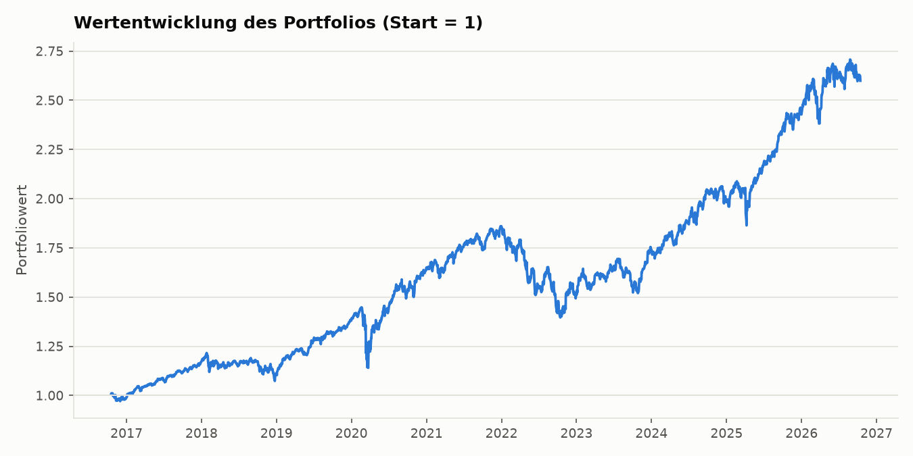
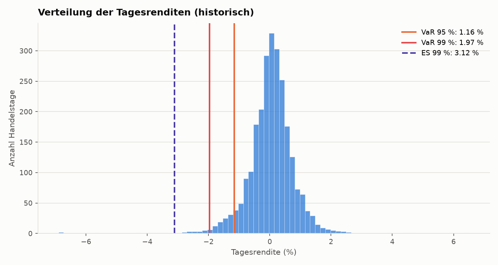
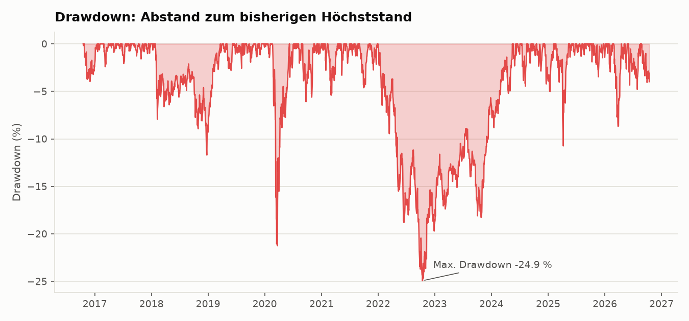
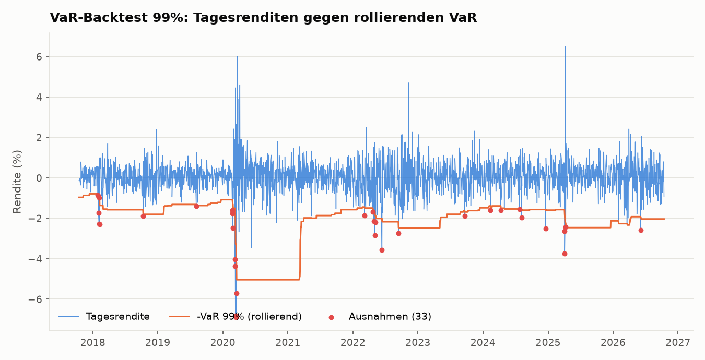

# Risikoanalyse eines Multi-Asset-Portfolios (VaR, Expected Shortfall, Drawdown)

Wie viel kann ein Portfolio aus fünf ETFs an einem Tag oder in zehn Tagen schlimmstenfalls verlieren, und wie gut hält ein Risikomodell in der Praxis? Das Projekt berechnet Value at Risk (VaR) und Expected Shortfall (ES) mit drei Methoden, bestimmt den maximalen Drawdown und prüft den VaR mit einem Backtest (Kupiec-Test).

## Daten

- Quelle: Yahoo Finance über `yfinance` (bereinigte Schlusskurse in USD)
- Zeitraum: Oktober 2016 bis Oktober 2026, 2.511 Handelstage
- Portfolio: SPY 40 %, EEM 15 %, TLT 20 %, GLD 15 %, VNQ 10 % (tägliches Rebalancing)

## Methode

- **VaR und ES:** historisch (empirisches Quantil), parametrisch (Normalverteilung) und Monte-Carlo (20.000 Simulationen, multivariate Normalverteilung), jeweils bei 95 % und 99 % Konfidenz sowie für 1 und 10 Tage
- **Maximaler Drawdown** und längste Phase unter dem Höchststand
- **Backtest:** rollierender historischer VaR mit 250 Handelstagen Fenster (ohne Blick in die Zukunft) und Kupiec-Test auf die Zahl der Ausnahmen

## Ergebnisse (Stand: 14.10.2026)

Betrachtet wurden 2.511 Handelstage von Oktober 2016 bis Oktober 2026. Der historische 1-Tages-VaR bei 95 % Konfidenz betrug 1,16 %, der Expected Shortfall 1,79 %. Bei 99 % lag der historische VaR bei 1,97 % und der ES bei 3,12 %. Die Normalverteilung unterschätzt die Extremverluste (parametrischer ES bei 99 %: 2,00 %). Der maximale Drawdown betrug 24,9 %.

Der Backtest des rollierenden historischen VaR zeigt 140 Ausnahmen statt der erwarteten 113 (95 %, Kupiec p = 0,012) und 33 statt 22,6 (99 %, p = 0,04). Das Modell wird bei einem Signifikanzniveau von 5 % in beiden Fällen abgelehnt. Die vollständigen Tabellen stehen in `output/risk_summary.csv` und `output/backtest_summary.csv`.

## Grenzen

- Die Normalverteilung unterschätzt seltene, extreme Verluste.
- Alle Kennzahlen beruhen auf vergangenen Daten, es gibt keine Prognose.
- Der p-Wert von 0,04 beim 99-%-Niveau liegt knapp unter der 5-%-Grenze.
- Der Kupiec-Test zählt nur die Zahl der Ausnahmen, nicht ob sie gehäuft auftreten.
- Keine Transaktionskosten und keine Währungseffekte.

## Nutzung

    pip install -r requirements.txt
    python analyze.py
    python -m pytest tests -v